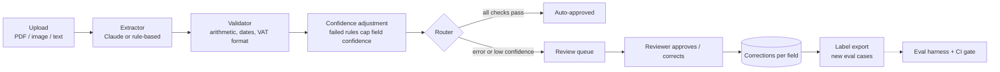

# Document Intelligence Pipeline

**Invoice extraction that knows when it might be wrong.** Upload a PDF, image or text invoice; Claude extracts structured data,
deterministic business rules check it, and anything uncertain goes to a human review queue instead of straight into the ledger.
Reviewer corrections are tracked per field and exported back as labelled evaluation data.

Built with **.NET 10 / ASP.NET Core**, the **Anthropic C# SDK** (structured outputs), EF Core + SQLite, and xUnit.
An evaluation harness with a CI quality gate measures it.

> In accounts payable a wrong number posted automatically costs far more than a number a human has to check.
> So the metric that matters is not raw accuracy. It is **how much flows through with no human, and how often what flows through is wrong.**

---

## How it works



| Stage | What it does | Why |
|---|---|---|
| **Extraction** | `ClaudeExtractor` sends the document (PDF and images natively, so no separate OCR step) with a strict JSON schema via structured outputs. The response must match the schema: every field, nullable where absent, plus a 0-1 confidence per field. | Schema-constrained output removes a whole class of parsing failures. The prompt says *copy, don't correct*: the model must not "fix" a supplier's arithmetic. |
| **Baseline** | `RuleBasedExtractor`: regex and heuristics for text documents. | A baseline to measure the LLM against, and lets the whole app and CI run with no API key. |
| **Validation** | `InvoiceValidator`: subtotal + tax = total, line items sum to subtotal, qty × unit price = amount, due date after invoice date, UK VAT number format, plausible UK VAT rate, ISO currency. | The model can be confidently wrong. Arithmetic catches a large share of those cases for free. |
| **Confidence adjustment** | Any field implicated in a failed rule is capped at 0.5; missing required fields drop to 0. | Model self-reported confidence is only loosely calibrated. Hard evidence overrides it. |
| **Routing** | Auto-approve only if there are no validation errors, every required field is ≥ 0.85 and every present optional field is ≥ 0.6. Thresholds live in `appsettings.json`. | Explicit, tunable trade-off between straight-through rate and risk. |
| **Human review** | Web UI shows *why* a document was flagged; the reviewer edits fields and approves or rejects. Required fields can't be blank on approval. | A human in the loop for the exceptions only. |
| **Feedback loop** | Each approval records which fields were corrected. `/api/stats` shows per-field correction rates, and `/api/labels/export` returns reviewed documents as labelled examples. | Production corrections become the next eval set and show which prompt rules or thresholds to tune. |

## Results

Evaluated on 80 synthetic invoices across four layouts of increasing difficulty
(`classic`, `modern` key/value with a markdown table, `email` prose, `ocr-noisy`). About 7% carry a deliberate printed arithmetic error.

**Rule-based baseline** (from [`reports/eval-rule-based.md`](reports/eval-rule-based.md), reproducible in CI):

| Metric | Rule-based |
|---|---|
| Field F1 (micro) | 80.7% |
| Documents fully correct | 42.5% |
| Straight-through (auto-approved) | 23.7% |
| **Auto-approved but wrong** | **21.1%** |
| Printed arithmetic errors caught | 100% |

| Layout | Fully correct | Field accuracy |
|---|---|---|
| classic | 90% | 99.1% |
| modern | 80% | 98.2% |
| ocr-noisy | 0% | 68.2% |
| email | 0% | 20.0% |

What this shows:

- Rules are great on the layout they were written for and collapse on prose and OCR damage. That is the case for an LLM.
- The validator caught **every** printed arithmetic error, regardless of extractor.
- The baseline's *auto-approved but wrong* rate (21%) is the real danger. Its confidence scores aren't calibrated, so it confidently omits fields it never found (for example non-UK VAT numbers). This is the number the Claude extractor is measured on.

**Claude extractor:** run `docintel-eval run --extractor claude` (see below) or the manual **Eval (Claude)** job in GitHub Actions,
which writes the same report with token usage and cost per document.

## Quick start

Requires the [.NET 10 SDK](https://dotnet.microsoft.com/download).

```bash
# Run the app (rule-based extractor when no key is set)
dotnet run --project src/DocIntel.Api --urls http://localhost:5080
# open http://localhost:5080 and drop files from data/eval/ onto the page
# API reference: http://localhost:5080/scalar

# Use Claude for extraction (PDFs and images need it)
export ANTHROPIC_API_KEY=sk-ant-...          # PowerShell: $env:ANTHROPIC_API_KEY="sk-ant-..."
dotnet run --project src/DocIntel.Api --urls http://localhost:5080

# Tests
dotnet test DocIntel.slnx
```

Docker:

```bash
docker build -t docintel .
docker run -p 8080:8080 -e ANTHROPIC_API_KEY=$ANTHROPIC_API_KEY -v docintel-data:/data docintel
```

## Evaluation harness

```bash
# Regenerate the labelled dataset (deterministic for a seed)
dotnet run --project src/DocIntel.Eval -- generate --out data/eval --count 80 --seed 42

# Score an extractor end-to-end (extract + validate + route)
dotnet run --project src/DocIntel.Eval -- run --extractor rule-based
dotnet run --project src/DocIntel.Eval -- run --extractor claude --limit 20 --effort medium

# Quality gate: exit code 1 if field F1 drops below the floor (used in CI)
dotnet run --project src/DocIntel.Eval -- run --extractor rule-based --min-f1 0.78
```

Each run writes `reports/eval-<extractor>.md` and `.json` with per-field precision, recall and F1, per-layout accuracy,
straight-through rate, auto-approved error rate, arithmetic-error catch rate, latency p50/p95, tokens and estimated cost.

**Adding real documents:** drop `my-invoice.pdf` next to a `my-invoice.truth.json` label in the dataset folder; the harness picks it up.
The API's `/api/labels/export` produces exactly these labels from reviewed documents.

Scoring is field-aware: `Northwind Analytics Limited` = `northwind analytics ltd.`, amounts compare to the penny,
and line items compare as a multiset of amounts. A wrong value counts as both a false positive and a false negative.

## API

| Method | Path | Purpose |
|---|---|---|
| `POST` | `/api/documents` | Upload (multipart `file`); returns extraction, confidence, issues, status |
| `GET` | `/api/documents?status=NeedsReview` | List / filter the queue |
| `GET` | `/api/documents/{id}` | Full detail |
| `GET` | `/api/documents/{id}/file` | Original document |
| `POST` | `/api/documents/{id}/review` | Approve with corrections |
| `POST` | `/api/documents/{id}/reject` | Reject with a reason |
| `GET` | `/api/stats` | Straight-through rate, per-field correction rates, model spend |
| `GET` | `/api/labels/export` | Reviewed documents as labelled eval examples |
| `GET` | `/health` | Health check (includes the database) |

## Project layout

```
src/
  DocIntel.Core/        extraction, validation, routing, evaluation, synthetic data - no web dependencies
    Extraction/         ClaudeExtractor, ExtractionContract (prompt + JSON schema + parsing), RuleBasedExtractor
    Validation/         InvoiceValidator
    Pipeline/           DocumentPipeline (extract -> validate -> adjust -> route), ReviewPolicy
    Evaluation/         FieldComparer, Evaluator, EvaluationReport, EvalDataset
    Synthetic/          InvoiceGenerator (fictional, publishable data)
  DocIntel.Api/         minimal API, EF Core + SQLite, review UI in wwwroot/
  DocIntel.Eval/        CLI: generate dataset, run evals, CI quality gate
tests/DocIntel.Tests/   validator, routing, parsing, metrics and API integration tests
data/eval/              80 labelled synthetic invoices
```

## Design decisions

- **Structured outputs over "please reply in JSON".** The schema marks every property required, uses nullable types for absent values, and forbids extra properties, so parsing can't fail on shape.
- **Model choice is configuration.** `Claude:Model` and `Claude:Effort` live in `appsettings.json`, and the eval CLI takes `--model` / `--effort`, so quality and cost trade-offs are measured, not guessed.
- **Server-side refusal fallback is on**, so a rare policy decline is re-served by a fallback model in the same call rather than failing the document.
- **Failures are kept, not dropped.** A failed extraction is stored with status `Failed` so it still reaches a human.
- **The prompt is versioned** (`ExtractionContract.PromptVersion`) and unit-tested separately from the HTTP call.

## Limitations and next steps

- The dataset is synthetic. It is realistic in structure but cleaner than real scans. Next: add a labelled set of real (redacted) PDFs from the label export.
- Confidence is model-reported, then adjusted by rules. Next: calibrate thresholds against reviewer correction rates (reliability curve per field).
- Processing is synchronous on upload. For volume: Azure Blob Storage for files, a Service Bus queue and worker, Azure SQL, deployed to Azure Container Apps with Bicep. The Message Batches API halves cost for back-office backfills.
- Compare against Azure AI Document Intelligence's prebuilt invoice model on the same eval set.

## Licence

MIT
